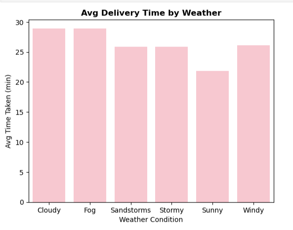
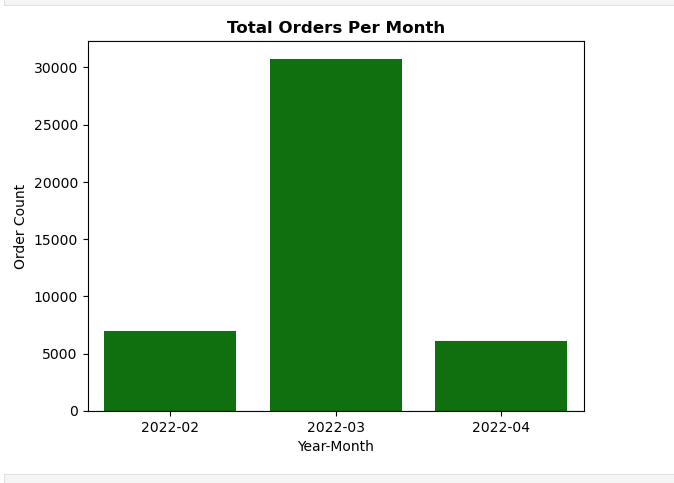

# Zomato Delivery Operations & Turnaround Time Analysis (Python)

## Project Overview
Exploratory Data Analysis (EDA) of Zomato food delivery operations examining how external factors (traffic congestion and weather conditions) and seasonal demand impact delivery turnaround times.

## Tools & Libraries
- **Python** (Pandas, NumPy) for data cleaning, date-time parsing, and aggregation
- **Matplotlib** for visual storytelling and operational bottleneck analysis

## Key Operational Insights
- **Traffic Impact:** Heavy congestion (**Jam**) increases average delivery time to **~33.7 minutes**, nearly **68% slower** than **Low** traffic conditions (**~20.2 minutes**).
- **Weather Impact:** **Cloudy** and **Foggy** conditions slow average deliveries to **~28.9 minutes**, compared to **~21.9 minutes** during **Sunny** weather.
- **Order Volume Spike:** Order volume surged in **March 2022 (~30,700+ orders)** compared to **February (~7,000)** and **April (~6,100)**, highlighting peak fleet allocation periods.

## Visual Analysis
### Delivery Time by Traffic Density

### Delivery Time by Weather Condition

### Monthly Order Volume Trend

